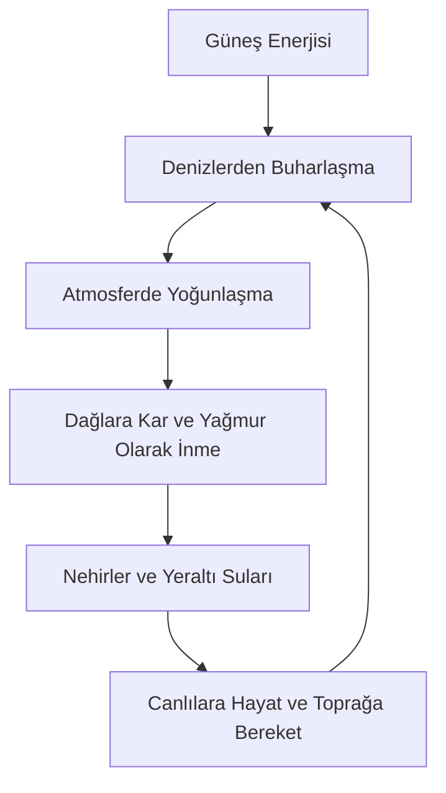

# 🌍 3. & 4. Mertebe: Arz (Yeryüzü), Denizler ve Nehirlerin Şehadeti

> *"Sonra o seyyah yere indi. Gördü ki, zemin yüzü gayet haşmetli bir ordugâh, gayet zengin bir erzak deposu ve gayet mükemmel bir misafirhanedir..."*

---

## 1. Seyyahın Arz (Yeryüzü) Müşahedesi

Yeryüzü, saatte 107.000 km hızla güneşin etrafında dönerken, üzerindeki hiçbir şeyi savurmayan, sarsmayan, mükemmel dengelenmiş bir sefine-i uzayiyedir (uzay gemisi):
* Toprak, kupkuru ve kara bir çamur iken bin bir renkli, kokulu ve lezzetli nimetlerin mutfağı hâline getirilmiştir.
* Her mevsimde yüz binlerce bitki ve hayvan türü sıfırdan, birbirine karıştırılmadan, gayet intizamlı ve süratli bir şekilde diriltilmektedir (Haşir numunesi).

---

## 2. Denizler ve Nehirlerin Müşahedesi

Seyyah denizlerin ve nehirlerin kenarına gelir:
* **Denizlerin Sınırları:** Devasa okyanuslar dünyayı kaplayıp boğabilecek bir kütledeyken, karaları istila etmez. İlahi bir sınırla yerinde durdurulmuştur (*"İki denizi birbirine kavuşmak üzere salıverdi. Aralarında bir engel vardır, birbirine geçip karışmazlar"* - Rahmân, 19-20).
* **Canlılar Ambarı:** Denizlerin altı milyonlarca balık ve deniz canlısıyla doludur. Her birinin beslenmesi, solunumu ve korunması kusursuz bir eko-sistemle tanzim edilmiştir.
* **Nehirlerin Şahdamarı:** Dağların zirvelerinden fışkıran tatlı su nehirleri, karaların en ücra köşelerine kadar uzanarak hayat taşır.

---

## 3. Oşinografi ve Jeofizik Entegrasyonu

* **Manyetik Kalkan:** Dünyanın sıvı demir çekirdeğinin ürettiği jeomanyetik alan (Van Allen Kuşakları), güneş fırtınalarını engeller.
* **Tuzluluk Oranı:** Denizlerdeki ortalama %3.5 tuzluluk dengesi, suyun kokuşmasını önlerken küresel okyanus akıntılarını (Termohalin sirkülasyonu / Gulf Stream) yönlendirir.

---

## 4. Tevhid Neticesi

Seyyah haykırır:
> *"Dünyayı bir beşik gibi sallayan, denizleri zengin bir ziyafetgâh kılan ve dağların başından tatlı suları fışkırtıp ovalara akıtan Kudret; ancak ve ancak bütün mülkün yegâne Mâliki olan Allâhu Zü'l-Celâl'dir."*
