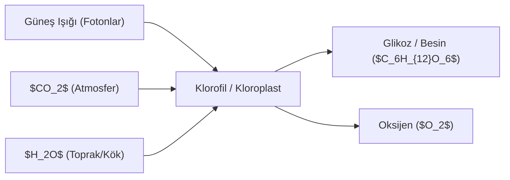

# 🌿 6. Mertebe: Nebatat, Ağaçlar ve Çekirdeklerin Şehadeti

> *"Sonra o seyyah, ağaçlara ve nebatata baktı. Gördü ki: Her bir ağaç ve nebat, gayet muazzam bir ilim ve hikmetle donatılmış, yüz binler dillerle Sâniini tesbih eden birer hatip hükmündedir..."*

---

## 1. Seyyahın Botanik Âlemindeki Müşahedesi

Seyyah bahçelere, ormanlara ve tarlalara girdiğinde şu mucizeleri görür:
1. **Basit Maddelerden Sonsuz Çeşitlilik:** Bütün ağaçlar aynı kara topraktan, aynı tatsız sudan ve aynı havadan beslenir. Fakat birinden tatlı bir incir, diğerinden ekşi bir nar, bir başkasından kokulu bir gül ve zehirli bir zakkum çıkar.
2. **Kupkuru Kemik Gibi Dallarda Canlı Şölen:** Kışın ölmüş gibi kuruyan odun parçaları, bahar geldiğinde bir emir almış gibi çiçek açar, yapraklanır ve taptaze meyvelerle ellerini doldurur.
3. **Köklerin Taşları Delmesi:** İpek gibi yumuşacık kök uçları, "Bismillah" der gibi sert kayaları ve taşları deler, toprağın derinliklerine nüfuz eder.

---

## 2. Çekirdeklerdeki Hafıza ve Kader Programı

Âyet-ül Kübra'da çekirdekler, **Hafîziyet** (her şeyi kaydedip koruma) ve **Kader** tecellisinin en bariz numunesi olarak gösterilir:
* Küçücük bir incir çekirdeği, devasa bir incir ağacının bütün programını, dallarının haritasını, yapraklarının şeklini ve meyvesinin lezzetini sinesinde taşır.
* Bu durum, modern genetikte keşfedilen DNA ve RNA yazılımının ontolojik karşılığıdır.
* Cansız ve şuursuz bir çekirdeğe bu muazzam enformasyonu yerleştiren ancak kâinatın geçmişini ve geleceğini aynı anda gören **Alîm-i Mutlak** olabilir.

---

## 3. Biyokimya ve Fotosentez Dengesi

* Fotosentez mekanizması olmasaydı, yeryüzündeki tüm oksijen kısa sürede tükenecek ve hayat sona erecekti.
* Bitkiler canlıların atığı olan zehirli karbondioksiti alıp, hayat kaynağı olan saf oksijeni üretir. Bu muazzam ekolojik takas, şuursuz bitkilerin insanı ve hayvanları düşünüp merhamet etmesiyle açıklanamaz; her iki âlemi de birbiriyle yardımlaştıran tek bir Rezzak-ı Kerîm'in tedbiridir.

---

## 4. Tevhid Delili

Seyyah nihai olarak şu hakikate erer:
> *"Bir tek çekirdeğin kalbinde koca bir ağacın programını saklayan Zât; elbette bütün kâinatın kâtibi ve yarının haşir sabahında bütün ölmüş insanları diriltecek olan Kadîr-i Zülcelâl'dir."*
