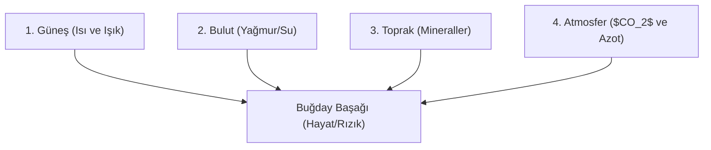

# 🤝 Tesanüd, Teavün, Teânuk ve Tecâvüb

> *"Kâinatın heyet-i mecmuasında öyle bir tesanüd ve teavün ve teânuk ve tecâvüb var ki; bütün kâinatı bir tek saray, bir tek fabrika, bir tek şahıs gibi idare eden tek bir Sâni' olduğunu bedahetle gösterir."*

---

## 1. Dörtlü Kozmik İttifak Zinciri

Âyet-ül Kübra risalesinde kâinattaki mükemmel ahenk ve iş birliğini ifade etmek üzere birbirini tamamlayan dört ana kavram kullanılır:

1. **Tesanüd (Dayanışma):** Varlıkların bir binanın kubbesini tutan taşlar gibi birbirine omuz vermesi, birbiriyle kenetlenmesi.
2. **Teavün (Yardımlaşma):** İhtiyaç sahibi mahlukatın imdadına, kendisinden tamamen habersiz başka varlıkların koşturulması.
3. **Teânuk (Kucaklaşma / Boyun Boyuna Sarılma):** Farklı ve zıt unsurların (ateş ile su, toprak ile hava) çatışmak yerine muhabbetle kucaklaşıp ortak bir gayeye hizmet etmesi.
4. **Tecâvüb (Cevaplaşma / Karşılıklı Yankılanma):** Bir varlığın fıtrî ihtiyacına kâinatın öteki ucundan anında cevap verilmesi.

---

## 2. Kozmik Eko-Sistem Örneği

Bir buğday başağının yetişmesini ele alalım:

* Güneş 150 milyon km uzaktan lambasını tutar.
* Bulut gökyüzünden süngeriyle suyunu döker.
* Toprak bağrındaki mineralleri şefkatle sunar.
* Hava yapraklarına soluk aldırır.

Bu unsurların hiçbirinde akıl, şuur, irade ve merhamet yoktur. Birbirlerini tanımazlar. Bir insanın midesini veya bir buğday tanesini bilmezler. O hâlde bu dört unsuru bir araya getirip o buğday tanesini yaratan; hem güneşe, hem buluta, hem toprağa ve hem de insan midesine aynı anda hükmeden **Hâlık-ı Külli Şey'dir**.

---

## 3. Sistem Teorisi (Systems Biology) ile Mukayese

Modern biyolojide ve sibernetikte "Sistemik Bütünlük" ve "Emergence" (Beliriş) ilkeleri, parçaların toplamından daha büyük ve organize bir bütünün ortaya çıktığını vurgular. Âyet-ül Kübra'daki tesanüd teorisi, indirgemeci atomculuğu (reductionism) reddederek kâinatın organik ve teleolojik bir bütün olduğunu kanıtlar.
