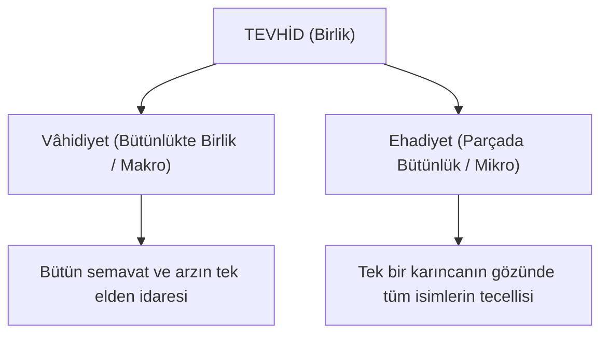

# ☀️ Vahdet (Vâhidiyet) ve Ehadiyet

> *"Vâhidiyet, bütün mevcudatta bir tecelli-i küllîdir. Ehadiyet ise, her bir şeyde esmâ-i hüsnânın bir cilve-i cüz'îsidir."*

---

## 1. Kavramların Teolojik Çerçevesi

İslâm tevhid anlayışında Allah'ın birliği iki temel tecelli dairesiyle izah edilir:

---

## 2. Vâhidiyet Nedir?

* **Kelime Anlamı:** Birlik, kapsayıcılık, küllî tecelli.
* **Istılahı:** Cenâb-ı Hakk'ın isim ve sıfatlarının kâinatın heyet-i mecmuasında (bütününde) tecelli etmesidir.
* **Örnek:** Güneşin ışığının yeryüzünün tamamını aydınlatması, kışın ardından baharın bütün yerkürede aynı anda diriltilmesi, bütün canlıların rızkının aynı anda idare edilmesi birer Vâhidiyet cilvesidir.
* **Zorluğu:** İnsan zihni bu küllî tecelliyi idrak etmekte zorlanabilir; koca kâinatı bir kerede ihata edemediği için gaflete düşebilir.

---

## 3. Ehadiyet Nedir?

* **Kelime Anlamı:** Teklik, ferdiyet, hususi tecelli.
* **Istılahı:** Cenâb-ı Hakk'ın bütün isim ve sıfatlarının cilvelerini, kâinatın en küçük bir ferdinde veya cüz'ünde odaklayarak göstermesidir.
* **Örnek:** Güneşin devasa ışığının aynı anda küçücük bir cam kırığında veya bir su damlasında bütün rengi, harareti ve parlaklığıyla yansımasıdır. Bir arının veya bir insanın yaratılışında bütün kâinatın fihristi ve esmânın özeti mevcuttur.
* **Kolaylığı:** İnsanın kalbi ve aklı, Ehadiyet tecellisi sayesinde doğrudan Cenâb-ı Hakk'a yönelebilir. "Bütün kâinatı yaratan Zât, şu an beni bizzat görüyor, kalbimin fısıltısını işitiyor ve rızkımı hususi olarak veriyor" diyebilir.

---

## 4. İki Tecellinin Âyet-ül Kübra'daki Fonksiyonu

Bediüzzaman Âyet-ül Kübra boyunca seyyahı hem **Vâhidiyet** ufkunda (semavat, galaksiler, atmosfer) gezdirerek haşmet ve celâl hissini tattırır; hem de **Ehadiyet** durağına (bir tohum, bir yavru kuşun gagası, bir hücre) indirerek şefkat, yakınlık ve cemâl müşahedesini kazandırır.
