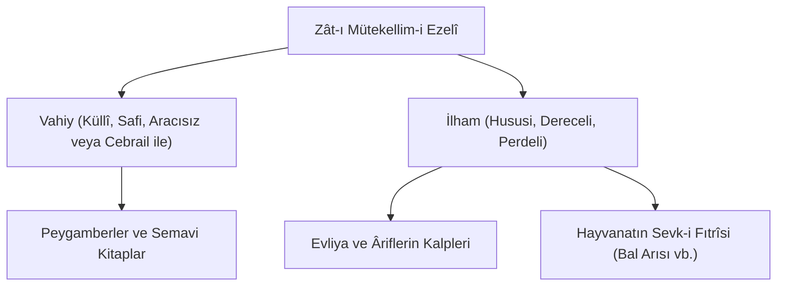

# ✨ 16. Mertebe: Vahiy ve Sadık İlhamların Şehadeti

> *"Gayb âleminin şuaları ve pencereleri olan vahiy ve ilham hakikati, kâinatın mâlikinin mahlukatıyla daimi mükâlemesini (konuşmasını) ispat eder."*

---

## 1. Seyyahın İlahi Kelâmı Müşahedesi

Seyyah kâinata bakar ve der ki:
Bir sanatkâr eserini yapıp terk etmez. İnsanları yaratan, onlara akıl ve kalp veren bir Hâlık; elbette onlarla konuşacak, kendini tanıtacak, emir ve yasaklarını bildirecektir. **Tekellüm (Konuşma)**, hayatın ve ilmin zorunlu bir neticesidir.

---

## 2. Vahiy ile İlham Arasındaki Hiyerarşi

Âyet-ül Kübra'da ilahi hitap, merkezden muhite yayılan ışık dalgaları gibi katman katman izah edilir:

1. **Vahiy:** Gölgesiz, berrak, umum beşeri bağlayan ve şeriat getiren en üst kelâm mertebesidir.
2. **Kudsî İlham:** Kalp tasfiyesi ile nura eren kullara verilen ferdi hidayet ve keşif pırıltılarıdır.
3. **Fıtrî İlham:** Kuşun uçuşunu, arının altıgen bal peteğini, karıncanın kışlık zahiresini bilmesi dahi ilahi kelâmın en alt dairesindeki tecellisidir.

---

## 3. Tevhid Neticesi

Seyyah teslimiyetle der:
> *"Her bir arıya ilham eden, her bir peygambere vahyeden ve Kendi ezelî kelâmıyla kâinatı aydınlatan Mütekellim-i Ezelî'den başka hiçbir ilâh yoktur!"*
