# 🗺️ Âyet-ül Kübra Zihin Haritası (Mind Map)

Bu belgede, seyyahın kâinat seyahatinde izlediği epistemolojik yol haritası Mermaid diyagramı ile görselleştirilmiştir.

---

## Kâinat Sarayında Tefekkür Yolculuğu

```mermaid
flowchart TD
    Seyyah(("🧭 Mütefekkir Seyyah"))
    
    subgraph MakroAlem["1. Kozmik & Âfâkî Boyut"]
        M1["1. Semavat & Yıldızlar<br/>(Kozmik Nizam & Çekim)"]
        M2["2. Cevv-i Sema & Bulutlar<br/>(Atmosfer & Rahmet Yağmurları)"]
        M3["3. Küre-i Arz<br/>(Dönen Misafirhane)"]
        M4["4. Denizler & Nehirler<br/>(Kevser Akıntıları)"]
        M5["5. Dağlar & Sahralar<br/>(Arzın Direkleri - Evtâd)"]
    end

    subgraph MikroAlem["2. Canlılar & Biyolojik Boyut"]
        M6["6. Eşcar & Nebatat<br/>(Çiçekler, Meyveler & Çekirdekler)"]
        M7["7. Hayvanat & Tuyur<br/>(Rızık Dengesi & Şefkat)"]
        M8["8. Zevilhayat & Ruh<br/>(Hayat Mucizesi)"]
    end

    subgraph SuurluAlem["3. İnsanlık & Nübüvvet Boyutu"]
        M9["9. İnsan Nev'i<br/>(Ahsen-i Takvim & Cami Mazhar)"]
        M10["10. Enbiyalar & Resuller<br/>(Mucizeler & İttifak)"]
        M11["11. Asfiya & Muhakkikler<br/>(Aklî Burhanlar)"]
        M12["12. Evliya & Ârifler<br/>(Kalp Gözü & Keşifler)"]
    end

    subgraph GaybAlemi["4. Melekût & Gayb Boyutu"]
        M13["13. Melaike & Ruhaniyat<br/>(Maddi Âlemin Müvekkel Zabıtları)"]
        M14["14. Akl-ı Selim & Vicdan<br/>(İç Pusula & Fıtrat)"]
        M15["15. Vahiy & Sadık İlhamlar<br/>(Gayb Âleminden Gelen Nurlar)"]
    end

    subgraph ZirveAlemi["5. Zirve: Risalet ve Kitap"]
        M16["16. Hz. Muhammed Aleyhissalâtü Vesselâm<br/>(Kâinatın Güneşi & Burhan-ı Nâtık)"]
        M17["17. Kur'an-ı Hakîm<br/>(Ezeli Hutbe & Kelâm-ı İlahi)"]
        M18["18. Kâinatın Heyet-i Mecmuası<br/>(Samediyet Sikkesi)"]
    end

    Hedef(["💎 ALLAHU LÂ İLÂHE İLLÂ HÛ<br/>(Vâcibü'l-Vücûd & Vâhid-i Ehad)"])

    Seyyah --> MakroAlem
    MakroAlem --> MikroAlem
    MikroAlem --> SuurluAlem
    SuurluAlem --> GaybAlemi
    GaybAlemi --> ZirveAlemi
    ZirveAlemi --> Hedef
```

---

## 📌 Diyagramın Kullanımı

* Bu zihin haritası; sunumlarda, atölye çalışmalarında ve bireysel tefekkür seanslarında eserin akışını bir bakışta kavramak için tasarlanmıştır.
* Markdown önizleyicilerde (GitHub, Obsidian, VS Code) otomatik olarak etkileşimli bir grafik şeklinde render edilir.
