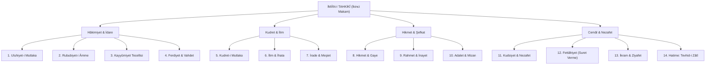

# 💎 Âyet-ül Kübra İkinci Makam: 14 Tevhid Hüccetinin Felsefi Mimarisi

> *"Âyet-ül Kübra'nın İkinci Babı, tahkikî imanın on dört parlak hüccet-i katıasını ve Esmâ-i Hüsnâ'nın kâinattaki kudsî tecellilerini beyan eder."*

---

## 1. İkinci Makamın Mahiyeti ve Gayesi

Birinci Makamda seyyah, kâinatı fiziki ve enfüsi duraklarıyla gezmiş ve eşyadan Sanatkâra intikal etmişti (**Burhan-ı İnnî**). 
İkinci Makamda ise bakış açısı daha aşkın bir boyuta taşınır: Esmâ-i İlahiye ve Sıfât-ı Rabbaniye ufkundan kâinata bakılır (**Burhan-ı Limmî**):
* "Eğer bir Uluhiyet varsa, elbette şirki kabul etmez."
* "Eğer mutlak bir Rububiyet varsa, her bir zerreye şamil bir terbiye olmak gerekir."
* "Eğer mutlak bir Kayyûmiyet varsa, evren bir an bile kendi haline bırakılamaz."

Bu makam, imanın taklitten tahkike, tahkikten "İlmelyakîn, Aynelyakîn ve Hakkalyakîn" derecelerine yükselmesini temin eden mantıkî bir zirvedir.

---

## 2. 14 Tevhid Hüccetinin Analitik Dökümü

---

## 3. İkinci Makamın Kazandırdığı Marifetullah

Bu 14 hüccet insan zihnindeki bütün inkâr ihtimallerini matematiksel olarak kapatır. Bir insanın "belki başka bir güç vardır" diyebileceği hiçbir kozmik köşe, hiçbir atom altı zerre bırakmaz. Her bir esma, kâinatın tamamını kaplayan bir nizam zinciri olarak gösterilir.
